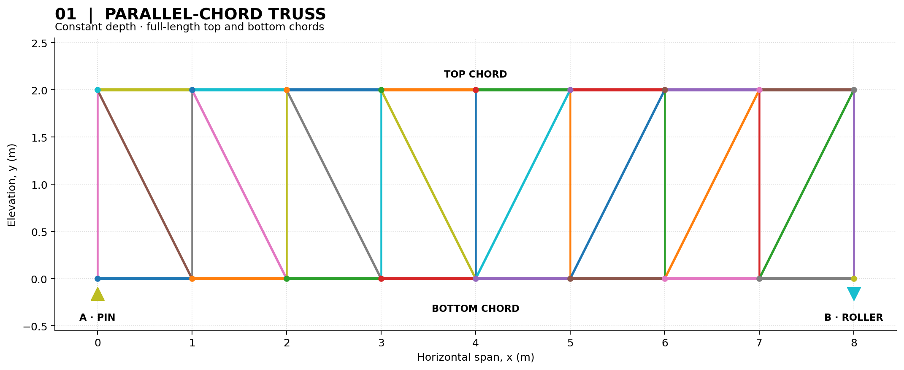
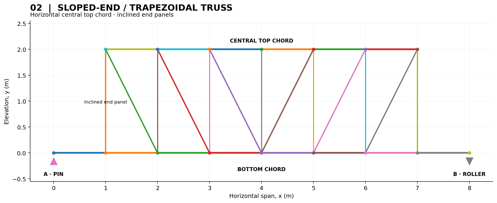
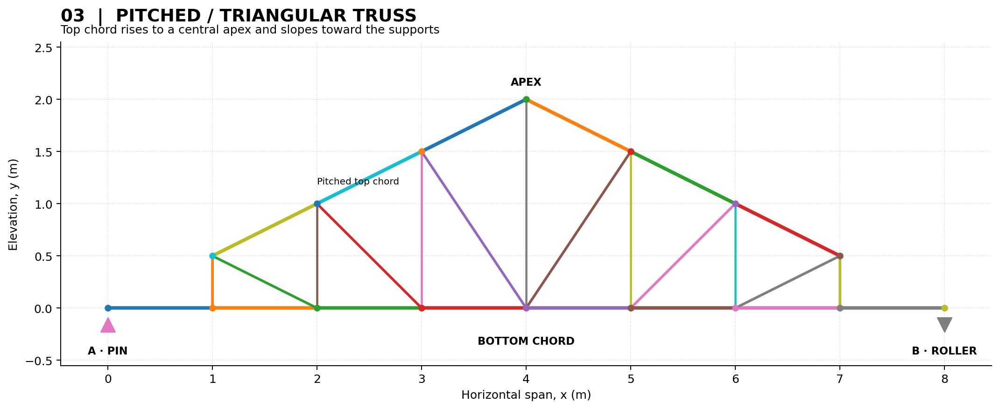

# OpenSeesPy Truss Analysis

**Structural modelling and linear static analysis of 2D trusses using Python and OpenSeesPy.**

This project explores the numerical analysis of planar truss structures, from geometric modelling and boundary-condition definition to the calculation and visualization of structural responses. It is designed as a practical learning project in computational structural engineering.

## Truss Geometries

The program considers three geometric configurations.

### 1. Parallel-Chord Truss

A configuration with horizontal top and bottom chords connected by vertical and diagonal members.



### 2. Parallel-Chord Truss with Sloped End Panels

A configuration combining parallel main chords with inclined end regions.



### 3. Pitched-Chord Truss

A configuration with an inclined top chord and a horizontal bottom chord, producing a pitched profile.



## Features

Depending on the selected configuration and implemented options, the project supports:

- **Geometric modelling:** definition of nodes and truss-member connectivity.
- **Structural properties:** assignment of material and cross-sectional properties.
- **Boundary conditions:** specification of support restraints.
- **Loading:** application of nodal loads.
- **Linear static analysis:** evaluation of the structural response.
- **Support reactions:** calculation of reactions at restrained degrees of freedom.
- **Nodal displacements:** evaluation of horizontal and vertical movements.
- **Member axial forces:** determination of axial forces and identification of tension or compression.
- **Visualization:** graphical presentation of the model and selected analysis results.

## Technologies

- [Python](https://www.python.org/)
- [OpenSeesPy](https://openseespydoc.readthedocs.io/)
- [NumPy](https://numpy.org/)
- [Matplotlib](https://matplotlib.org/)

## Requirements

Python 3.12 is the version indicated in the development environment; compatibility with other Python versions depends on the OpenSeesPy and Matplotlib releases available for that version.

## Installation

### 1. Clone the repository

```bash
git clone https://github.com/Maglwe/Truss
cd Truss
```

### 2. Create and activate a virtual environment

On Windows using PowerShell:

```powershell
py -3.12 -m venv .venv
.venv\Scripts\Activate.ps1
```

On Linux or macOS:

```bash
python3.12 -m venv .venv
source .venv/bin/activate
```

### 3. Install the dependencies


```bash
python -m pip install -r requirements.txt
```

## Running the Analysis

From the project directory, run the main Python script:

```bash
python truss_analysis.py
```

The program should construct the selected model, apply its boundary conditions and loads, perform the analysis, and display or report the results implemented in the script.

## Interpreting the Results

The calculated results may include:

- Support reactions.
- Nodal displacements.
- Axial forces in individual members.
- Tensile and compressive member forces.
- Structural plots and result summaries.

The sign convention used by the program determines how positive and negative axial forces are interpreted. Check the code's output definitions before interpreting the results.

## Project Structure


```text
.
├── truss_analysis.py
├── requirements.txt
├── README.md
├── LICENSE
└── images/
    ├── geometry_01_parallel_chord.png
    ├── geometry_02_sloped_end_panels.png
    ├── geometry_03_pitched_triangular.png
    └── badges/
        ├── python-essentials-1.png
        └── python-essentials-2.png
```


## Author

**Makiliwé AMOUZE-BAKOUPETERI**

### Python Credentials

I have completed the following Python courses, issued by Cisco in collaboration with the OpenEDG Python Institute.

**Python Essentials 1**

[](https://www.credly.com/badges/d6bd7402-d942-4bf4-8b83-3d48f26ab115/public_url)

[View credential on Credly](https://www.credly.com/badges/d6bd7402-d942-4bf4-8b83-3d48f26ab115/public_url)

**Python Essentials 2**

[](https://www.credly.com/badges/aa45877d-71af-4384-87d0-442d33753fe0/public_url)

[View credential on Credly](https://www.credly.com/badges/aa45877d-71af-4384-87d0-442d33753fe0/public_url)

## License

This project is distributed under the MIT License. See the [`LICENSE`](LICENSE) file for details.

## Disclaimer

This project is intended for educational and research purposes. Its results depend on the model geometry, boundary conditions, loading, and analysis implementation. They should not be used directly for real-world structural design without appropriate verification and independent engineering review.